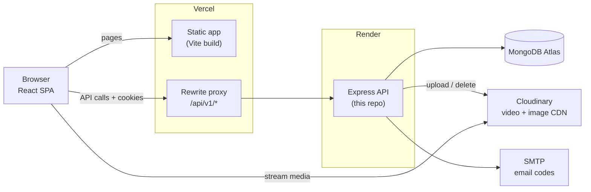
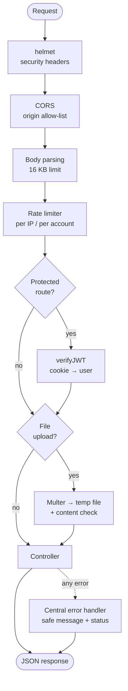
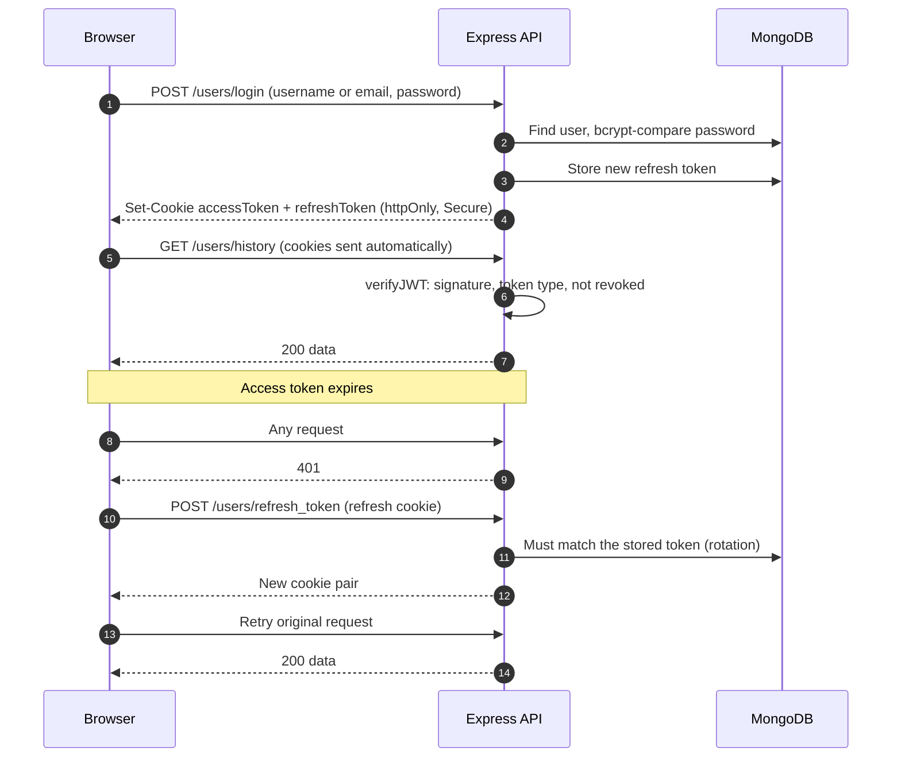
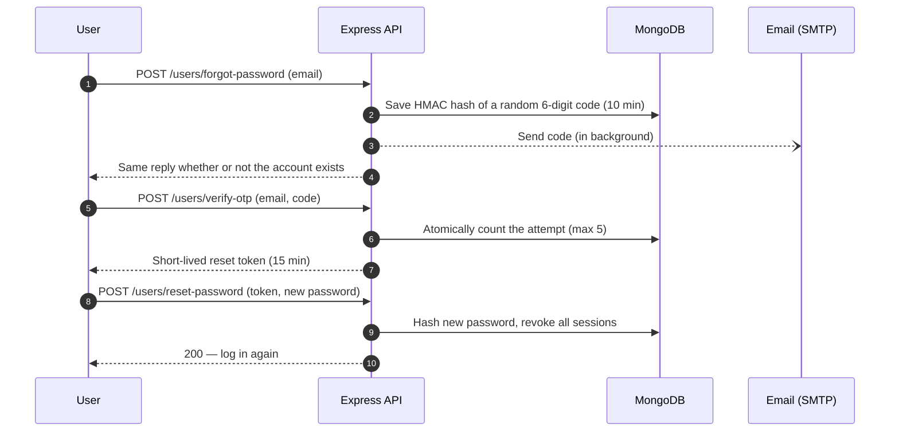
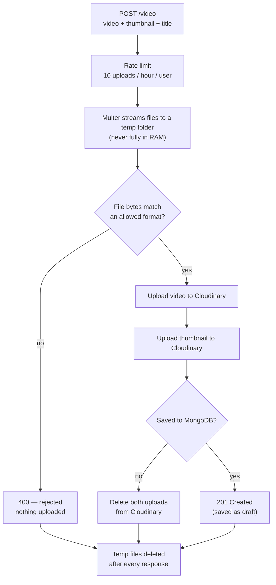
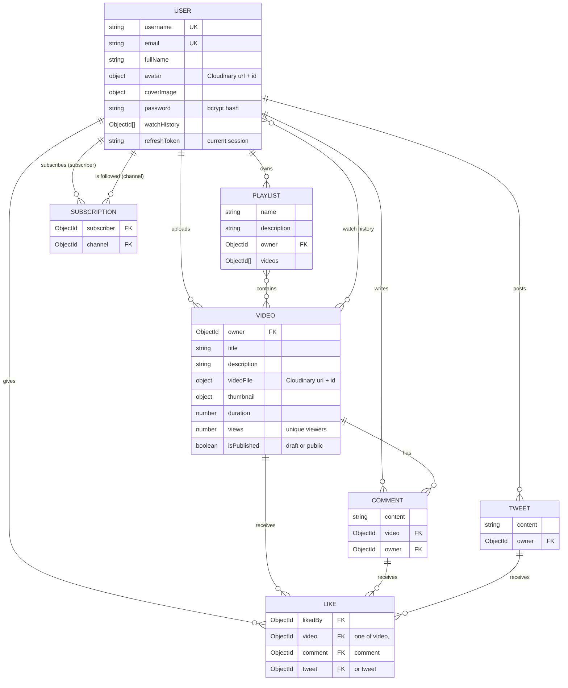

# VideoMela — Backend API

[](https://video-mela.vercel.app)
[](https://github.com/vikrant48/Video_Mela_frontend)


REST API powering **VideoMela**, a YouTube-style video platform: upload and stream videos, comment, like, subscribe to channels, build playlists, post short updates, and track channel stats. Built end to end with Node.js, Express and MongoDB, with media on Cloudinary.

> **Try it:** [video-mela.vercel.app](https://video-mela.vercel.app) · The API runs on Render's free tier, so the first request after idle can take ~30 s to wake up.

---

## Highlights

- **46 REST endpoints** across 9 resources (users, videos, comments, likes, subscriptions, playlists, posts, dashboard, health), backed by **7 MongoDB collections**.
- **Complex MongoDB aggregation pipelines** for the paginated feed, channel profiles with subscriber counts, comment threads with like state, watch history and creator analytics.
- **Secure cookie-based auth**: `httpOnly` JWT cookies, refresh-token rotation, sessions revoked on password change, no tokens ever exposed to JavaScript.
- **Email flows** with one-time codes: password reset and verified email change (hashed, attempt-limited codes).
- **Production-grade media pipeline**: uploads streamed to disk (not RAM), file type checked by its actual bytes, Cloudinary storage with automatic cleanup on failure.
- **Security-hardened** after a full code review: NoSQL-injection protection, rate limiting, security headers, ownership checks, safe error responses — [details below](#security).
- **Deployable anywhere**: Docker image (Node 22, non-root), graceful shutdown, config validated at startup.

---

## Architecture

The React frontend and this API are deployed separately. The browser only ever talks to the frontend's domain: Vercel serves the app and forwards `/api/v1/*` to the API on Render, so auth cookies stay first-party.



### Request pipeline

Every request passes through the same middleware chain before reaching a controller. Errors from any step end up in one central handler.



---

## Key flows

### Login and session refresh

Tokens live only in `httpOnly` cookies, so page scripts can never read them. Access tokens are short-lived; the refresh token is rotated on every use and stored server-side, so a stolen one stops working.



Changing or resetting a password revokes every existing session (other devices are signed out).

### Password reset with email code



### Video upload



---

## Data model



Unique indexes enforce one like per user per item and one subscription per user per channel, even under concurrent requests. Original design workspace: [Eraser.io](https://app.eraser.io/workspace/OO3HFmjKmUYmLl8JiwRk?origin=share).

---

## Security

Hardened through a full security review of the codebase. Main measures:

| Area | What's in place |
|---|---|
| **Authentication** | `httpOnly` + `Secure` cookies only (no tokens in JSON or `localStorage`), refresh-token rotation, typed tokens, sessions revoked on password change |
| **Brute force** | Rate limits per IP and per account (login, sign-up, codes, uploads); email codes limited to 5 attempts and stored hashed |
| **Account enumeration** | Identical responses and timing for "no such account" vs "wrong password" |
| **Injection** | Strict input type checks plus Mongoose `sanitizeFilter`; sort fields allow-listed |
| **Authorization** | Ownership checks on every edit/delete (403), unpublished videos hidden from other users everywhere |
| **Uploads** | Disk streaming with size caps, real file-type check by magic bytes (blocks HTML/SVG/executables), temp-file cleanup |
| **Responses** | `helmet` security headers, `no-store` caching, central error handler that never leaks internal details |
| **Operations** | Config validated at startup, crash logging, graceful shutdown, dependencies audited |

---

## API reference

Base path: `/api/v1`. 🔒 = requires login.

<details>
<summary><b>Users & auth</b> — 15 endpoints</summary>

| Method | Endpoint | Description |
|---|---|---|
| POST | `/users/register` | Sign up (avatar required, cover optional) |
| POST | `/users/login` | Log in with username or email |
| POST | `/users/logout` 🔒 | Log out and end the session |
| POST | `/users/refresh_token` | Rotate the session cookies |
| GET | `/users/current_user` 🔒 | Logged-in user's profile |
| POST | `/users/change_password` 🔒 | Change password (signs out other devices) |
| PATCH | `/users/update_account` 🔒 | Update name; email change requires password + emailed code |
| POST | `/users/verify-email-change` 🔒 | Confirm a new email with its code |
| PATCH | `/users/avatar` 🔒 | Replace avatar |
| PATCH | `/users/coverImage` 🔒 | Replace cover image |
| GET | `/users/c/:username` 🔒 | Channel profile with subscriber counts |
| GET | `/users/history` 🔒 | Watch history |
| POST | `/users/forgot-password` | Email a reset code |
| POST | `/users/verify-otp` | Exchange the code for a reset token |
| POST | `/users/reset-password` | Set a new password |
</details>

<details>
<summary><b>Videos</b> — 6 endpoints</summary>

| Method | Endpoint | Description |
|---|---|---|
| GET | `/video` | Public feed: search, sort, paginate, filter by channel |
| POST | `/video` 🔒 | Upload a video + thumbnail (saved as draft) |
| GET | `/video/v/:videoId` 🔒 | Watch a video (likes, subscriber info, counts a view) |
| PATCH | `/video/v/:videoId` 🔒 | Edit title, description, thumbnail (owner only) |
| DELETE | `/video/v/:videoId` 🔒 | Delete with its comments, likes and playlist entries |
| PATCH | `/video/toggle/publish/:videoId` 🔒 | Publish / unpublish |
</details>

<details>
<summary><b>Social</b> — comments, likes, subscriptions, posts (15 endpoints)</summary>

| Method | Endpoint | Description |
|---|---|---|
| GET / POST | `/comment/:videoId` 🔒 | List (paginated) / add comments |
| PATCH / DELETE | `/comment/c/:commentId` 🔒 | Edit / delete own comment |
| POST | `/likes/toggle/v/:videoId` 🔒 | Like or unlike a video |
| POST | `/likes/toggle/c/:commentId` 🔒 | Like or unlike a comment |
| POST | `/likes/toggle/t/:tweetId` 🔒 | Like or unlike a post |
| GET | `/likes/videos` 🔒 | Liked videos |
| GET / POST | `/subscriptions/c/:channelId` 🔒 | Channel's subscribers / subscribe or unsubscribe |
| GET | `/subscriptions/u/:subscriberId` 🔒 | Channels a user follows, with latest video |
| POST | `/tweet` 🔒 | Create a post |
| GET | `/tweet/user/:userId` 🔒 | A user's posts |
| PATCH / DELETE | `/tweet/:tweetId` 🔒 | Edit / delete own post |
</details>

<details>
<summary><b>Playlists, dashboard, health</b> — 10 endpoints</summary>

| Method | Endpoint | Description |
|---|---|---|
| POST | `/playlist` 🔒 | Create a playlist |
| GET / PATCH / DELETE | `/playlist/:playlistId` 🔒 | View / edit / delete (owner only for changes) |
| PATCH | `/playlist/add/:videoId/:playlistId` 🔒 | Add a video |
| PATCH | `/playlist/remove/:videoId/:playlistId` 🔒 | Remove a video |
| GET | `/playlist/user/:userId` 🔒 | A user's playlists |
| GET | `/dashboard/stats` 🔒 | Channel totals: views, subscribers, likes, videos |
| GET | `/dashboard/videos` 🔒 | All own videos incl. drafts |
| GET | `/healthcheck` | Liveness check |
</details>

Responses share one shape: `{ statusCode, success, message, data }` on success, and `{ statusCode, success: false, message, errors }` on failure.

---

## Tech stack

| Layer | Technology |
|---|---|
| Runtime / framework | Node.js 22, Express 4 (ES modules) |
| Database | MongoDB Atlas, Mongoose 8 (aggregation pipelines, Atlas Search) |
| Media | Cloudinary, Multer |
| Auth & security | jsonwebtoken, bcrypt, cookie-parser, helmet, express-rate-limit |
| Email | Nodemailer (SMTP) |
| Deployment | Docker, Render (API), Vercel (frontend + API proxy) |

## Project structure

```text
backend/
├── server.js                 # Entry: startup, crash handling, graceful shutdown
├── src/
│   ├── bootstrap.js          # Loads and validates config before anything else
│   ├── app.js                # Express app: middleware chain and routes
│   ├── routes/               # URL → controller mapping per resource
│   ├── controllers/          # Business logic (one file per resource)
│   ├── models/               # Mongoose schemas and indexes
│   ├── middlewares/          # Auth, uploads, rate limits, error handler
│   └── utils/                # ApiError, ApiResponse, Cloudinary, email, logger
├── scripts/                  # One-off data migrations (dry run by default)
└── Dockerfile
```

---

## Running locally

**Prerequisites:** Node.js 22+, a MongoDB Atlas cluster, a Cloudinary account, and optionally SMTP credentials (without them, email codes are printed to the console in development).

```bash
git clone https://github.com/vikrant48/Video_Mela_backend.git
cd Video_Mela_backend
npm install
cp .env.example .env      # then fill in your values
npm run dev               # http://localhost:8000/api/v1/healthcheck
```

| Variable | Purpose |
|---|---|
| `MONGODB_URI` | Cluster URI without database name (the app appends `/videomela`) |
| `ACCESS_TOKEN_SECRET`, `REFRESH_TOKEN_SECRET` | Two different long random strings |
| `ACCESS_TOKEN_EXPIRY`, `REFRESH_TOKEN_EXPIRY` | e.g. `1d`, `10d` (these defaults apply if unset) |
| `CLOUDINARY_CLOUD_NAME`, `CLOUDINARY_API_KEY`, `CLOUDINARY_API_SECRET` | Media storage |
| `LOCAL_FRONTEND_URL`, `FRONTEND_URL` | Allowed frontend origins (CORS) |
| `SMTP_HOST`, `SMTP_PORT`, `SMTP_USER`, `SMTP_PASS`, `SMTP_FROM` | Email for reset / verification codes |
| `TRUST_PROXY_HOPS` | `2` behind the Vercel proxy + Render, `1` when called directly |

The server refuses to start, with a clear message, if a required variable is missing.

## Deployment

```bash
docker build -t videomela-backend .
docker run -p 8000:8000 --env-file .env videomela-backend
```

The image runs Node 22 as a non-root user without dev dependencies or `.env`, and shuts down gracefully on `SIGTERM`. In production the API runs on Render; the frontend on Vercel proxies `/api/v1/*` to it.

Data migrations in `scripts/` (run with `node scripts/<name>.js`, add `--apply` to change data):

| Script | Purpose |
|---|---|
| `lowercase-emails.js` | Normalise stored emails to lowercase |
| `dedupe-likes-subscriptions.js` | Remove duplicates, then build unique indexes |
| `https-media-urls.js` | Upgrade stored `http://` Cloudinary URLs to `https://` |

---

## Author

**Vikrant** — designed and built the full stack (React frontend and this API).
[Frontend repository](https://github.com/vikrant48/Video_Mela_frontend) · [Live demo](https://video-mela.vercel.app)
